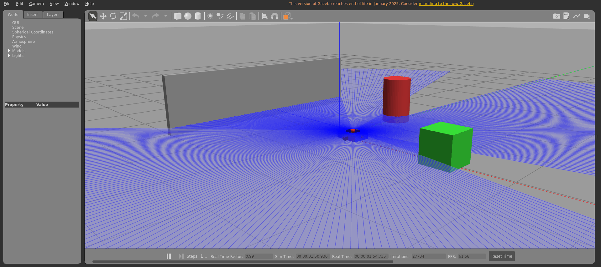
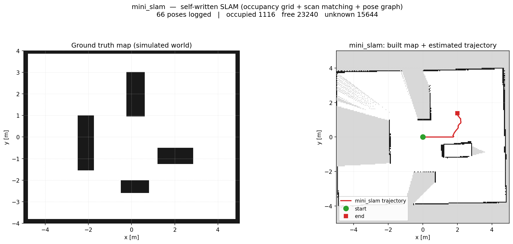

# ROS 2 移动机器人软件栈实践

> ROS 2 Humble / C++17 / Ubuntu 22.04

一套差速移动机器人软件栈，包含两条演进线路：**早期用 Gazebo 做物理仿真**（URDF/xacro + world + 传感器插件），**后期改成自写 `ros2_control` 硬件接口 + ray-cast 激光模拟**的轻量仿真——不依赖 Gazebo、启动约 3 秒，承载 Nav2 + AMCL 导航、两级 EKF 融合与话题级安全链。两条线路都保留在仓库里，配置互不通用。

## 能力一览

| 模块 | 实现 | 关键点 |
|---|---|---|
| 底盘 | `ros2_control` SystemInterface 插件（pluginlib） | 100 Hz 闭环；电机惯量、粘滞摩擦、4096 线编码器量化建模；velocity / effort 双模式 |
| 定位 | `robot_localization` 两级 EKF + AMCL | odom 系融合轮速/IMU，map 系融合 AMCL；AMCL 关闭 `tf_broadcast` 避免 TF 双发布 |
| 导航 | Nav2（map_server / 规划 / 控制 / costmap） | 定点导航、航点巡逻；`use_sim_time=false` |
| 安全 | watchdog → collision_monitor → 底盘适配器 | 0.5 s 无指令急停；0.7 m 减速 40%、0.28 m 急停；雷达断流 2 s 停车 |
| 通信 | rclcpp + Fast DDS | QoS 按数据类型选型；loaned message 零拷贝；回调组隔离耗时任务 |
| 算法 | 自研 `mini_slam`（不依赖 `slam_toolbox` / `nav2_amcl`） | 占据栅格建图、相关性扫描匹配、位姿图回环 + 回环后重建地图、AMCL、5 维 EKF；算法层零 ROS 依赖，38 个 gtest 用例 3 秒跑完 |

## 仿真效果

### Gazebo 物理仿真



差速底盘在 Gazebo 场地中运动：蓝色扇形是 2D 激光雷达的射线，红色圆柱与绿色方块是障碍物。
底部状态栏显示 **实时因子 0.99、渲染 61.6 FPS** —— 物理步长与渲染都没有掉速。

> 这是早期的**线路 B**（Gazebo 插件）。主线**线路 A** 已改为自写 `ros2_control`
> 硬件接口 + ray-cast 激光模拟，不依赖 Gazebo、启动约 3 秒。两条线路配置不通用，
> 见下文「两条技术线路」。

### 自研 SLAM 建图



左：仿真世界的真值地图。右：`mini_slam` 自己建出来的地图 + 估计轨迹（绿点起点、红方终点）。

| 项 | 值 |
|---|---|
| 输入 | 676 帧 2D 激光（10 Hz）+ `/odom` |
| 关键帧 | 18 |
| 占据 / 空闲 / 未知 | 1116 / 23240 / 15644 格 |
| 代码规模 | 约 2500 行；算法层零 ROS 依赖，38 个 gtest 用例 3 秒跑完 |

> 右图墙体有约 10° 倾斜：这一跑**没有触发回环闭合**，累积漂移没有被修正。
> 这是原始输出，没有做美化 —— 也正说明为什么需要后端回环：注入闭合路径后，
> 回环会把轨迹拉正，并用优化位姿重建整张地图。

## 架构

```
                     ┌──────────────────────────── 控制与安全 ────────────────────────────┐
 /cmd_vel ──────────▶│ watchdog ──▶ /cmd_vel_safe ──▶ collision_monitor ──▶ /cmd_vel_final │
                     │ 0.5 s 无指令急停            0.7 m 减速 40% / 0.28 m 急停            │
                     └───────────────────────────────────┬─────────────────────────────────┘
                                                         │ cmd_vel_adapter
                                                         ▼
 ┌───────────────┐     ┌──────────────────────┐     ┌──────────────────────────────────┐
 │ laser_scan_sim│────▶│        Nav2          │     │        ros2_control_node         │
 │  ray cast     │/scan│ planner / controller │     │  DiffDriveHardware + ImuSensor   │
 └───────────────┘     └──────────┬───────────┘     │  100 Hz read() / write()         │
                                  │ /odom           └───────────────┬──────────────────┘
                                  ▼                                 │ /joint_states
 ┌───────────────┐     ┌──────────────────────┐                     │ /imu
 │     AMCL      │────▶│      ekf_local       │◀────────────────────┘
 │  map → odom   │     │  odom → base_link    │
 └───────┬───────┘     └──────────────────────┘
         │ /amcl_pose
         ▼
 ┌───────────────┐
 │  ekf_global   │  map → odom（融合 AMCL + 局部速度）
 └───────────────┘
```

## 快速开始

### 0. 环境

- Ubuntu 22.04 + ROS 2 Humble（桌面版）
- 依赖：`ros-humble-navigation2`、`ros-humble-nav2-bringup`、`ros-humble-robot-localization`、`ros-humble-ros2-control`、`ros-humble-ros2-controllers`、`ros-humble-xacro`

```bash
source /opt/ros/humble/setup.bash
cd ~/ros2
rosdep install --from-paths src --ignore-src -r -y
colcon build --symlink-install
source install/setup.bash
```

### 1. 线路 A：ros2_control 独立线（主线，无需 Gazebo）

```bash
# 终端 1：底盘 + 传感器 + 安全链 + 局部 EKF
ros2 launch my_robot_control robot.launch.py

# 终端 2：地图 + AMCL + 全局 EKF + Nav2
ros2 launch my_robot_control nav2_standalone.launch.py
```

预期：`/scan` 10 Hz、`/odom` 50 Hz、`/imu` 100 Hz；RViz2 中 `map → odom → base_link` 三段 TF 完整。

```bash
# 发一个目标点
ros2 action send_goal /navigate_to_pose nav2_msgs/action/NavigateToPose \
  "{pose: {header: {frame_id: map}, pose: {position: {x: 2.5, y: -1.5}}}}"
```

### 2. 线路 B：Gazebo 仿真线

```bash
ros2 launch my_robot_description gazebo.launch.py
```

用于快速验证导航/任务逻辑，底盘由 `libgazebo_ros_diff_drive.so` 驱动，全程 `use_sim_time=true`。

也可以一条命令起全栈（约 18 秒就绪）：

```bash
ros2 launch my_robot_description bringup_all.launch.py
```

## 实测数据

| 指标 | 实测值 |
|---|---|
| 控制周期 | 100 Hz（read/write 各一次） |
| `/joint_states`、`/imu` | 99.99 Hz |
| `/odom` | 50.01 Hz |
| `map→odom` / `odom→base_link` | 22.4 Hz / 23.6 Hz |
| 定点导航 (0,0) → (2.5,-1.5) | 17.1 s，到位误差 0.100 m |
| EKF 抗噪（注入 10% 里程计偏差） | 偏差消除 91%（误差 22.6° → 2.0°） |
| 安全链触发点 | 减速 0.698 m / 急停 0.265 m（设计值 0.70 / 0.28） |
| 零拷贝（1 MB @ 10 Hz） | 端到端延迟下降约 30% |

## 目录结构

```
src/
├── my_robot_control/      # 主线：ros2_control 硬件插件、Nav2、两级 EKF、安全链（不依赖 Gazebo）
├── my_robot_tasks/        # 任务层：航点巡逻、视觉目标导航、里程计噪声注入
├── my_robot_description/  # Gazebo 仿真线：URDF/xacro、world、仿真侧 nav2/ekf 配置
├── my_robot_interfaces/   # 自定义 msg / srv
├── my_first_pkg/          # 基础示例（Topic/Service/Action/QoS/Executor/TF2 等 35 个 demo）
├── robot_math/            # 纯 C++ 运动学库（不依赖 rclcpp，可被 gtest 直接测）
├── robot_math_demo/       # 消费 robot_math 的 find_package 导出链路示例
└── qos_lab/               # QoS 兼容性矩阵与 lifespan 实验
docs/features/             # 各模块设计与实验记录（11 篇）
docs/learning/             # L0 工程层 / L1 通信层学习笔记
docs/notes/                # ros2_control / TF2 / 行为树 / 安全与通信速查
tools/                     # bag 指标、指令时间线等分析脚本
```

## 两条技术线路（配置不通用，务必先看）

**演进方向**：最早用 Gazebo（线路 B）验证行为；为了摆脱 Gazebo 的重依赖、启动慢和 `/clock` 节流问题，后期改写成自写硬件接口 + ray-cast 的轻量仿真（线路 A），并作为主线继续演进。

仓库里有两条并行线路，**同名配置文件内容不同，不能混用**：

| | 线路 A：ros2_control 独立线（主线） | 线路 B：Gazebo 仿真线 |
|---|---|---|
| 底盘 | 自写 `SystemInterface` 插件（含电机惯量/摩擦/编码器量化） | `libgazebo_ros_diff_drive.so` |
| 传感器 | 自写 ray-cast 激光 + `SensorInterface` IMU | Gazebo 插件 |
| 配置目录 | `my_robot_control/config/` | `my_robot_description/config/` |
| 时间源 | 墙钟，`use_sim_time=false` | `/clock`，`use_sim_time=true` |
| 启动 | `robot.launch.py` + `nav2_standalone.launch.py` | `gazebo.launch.py` |
| 用途 | 验证控制链路、硬件接口、安全链 | 验证导航与任务逻辑 |

**切换线路时整目录切换**：用哪条线，就 `source` 哪条线的 launch，两边的 `nav2_params*.yaml`、`ekf_*.yaml`、`collision_monitor.yaml` 互不兼容——只替换单个文件会出现 TF 双发布或参数不生效。

## 核心实现

- **ros2_control 硬件插件**：`on_init` 分配接口内存、`on_configure` 只清零；`read()` 做编码器量化，`write()` 用 `dω/dt = (τ - b·ω) / J` 模拟电机。踩过的坑写在 `docs/features/11-ros2-control.md`。
- **两级 EKF**：local 在 odom 系融合轮速 + IMU，global 在 map 系融合 AMCL，把定位跳变挡在底盘控制环之外。见 `docs/features/10-two-stage-ekf.md`。
- **安全链**：watchdog 管"没指令"，collision_monitor 管"会撞"，串联顺序不可颠倒。见 `docs/features/07-safety.md`。
- **零拷贝**：`borrow_loaned_message` + Fast DDS `data_sharing` profile，对比普通发布的端到端延迟。

## 踩过的坑

调试过程中真实遇到、定位过、修掉的问题。每条都写了「现象 → 根因 → 修法」，
以后再碰到同类现象可以直接对照。

### 路径与安全链

| 现象 | 根因 | 修法 |
|---|---|---|
| 规划好的一段路，车走到一半**卡住不动**，SLAM 位姿也定在那儿不变 | 路径离障碍只有 **0.45 m**，车头顶到了障碍。`collision_monitor` 的 `PolygonSlowdown` 在 **0.70 m**、`PolygonStop` 在 0.28 m | **规划路径按 0.70 m 留余量，不是按车身半径**。实测：0.55 m 能过（只是减速），0.45 m 会被卡死，阈值在 0.5 m 附近 |
| 转头指令 90°，实际只转了 45° | 转弯位置落在 0.7 m 减速区内，速度被砍到 40%，而驱动脚本按**固定时间**开环发指令 | 驱动改成**闭环**：订阅 `/odom`，转够角度就停 |
| 转头指令 90°，实际转了约 100° | 判定到位后还发了 0.4 s 的指令（最后一个周期 + 停车脉冲），0.4 rad/s × 0.4 s = 9° | 加**提前量**（剩余量 <= rate×0.5 就发停），停车脉冲从 6 次减到 3 次 |
| 转头越"补正"越偏，90° 一路补到 135° | 闭环里对角度用了 `abs()`，符号丢了。转多之后误差变负，补正分支**仍然发同方向的角速度**，越补越多 | 角度**全程带符号**：`target = turn`（不取 abs），补正方向 = `copysign(rate, err)` |
| 分段用 `ros2 topic pub` 发指令，车走走停停、转身全丢 | `ros2 topic pub` 是 CLI，每次启动 1~2 s，两次调用之间的空档超过 watchdog 的 0.5 s 超时 | 改用**单进程 Python 节点**连续 publish（`tools/drive_square.py`） |

### 传感器与建图

| 现象 | 根因 | 修法 |
|---|---|---|
| 建出来的墙被抹成放射状条纹，内部障碍物完全不见 | 激光装在车头前方 **0.10 m**，而建图/扫描匹配把 `base_link` 位姿当成了激光原点。偏差方向随车头朝向旋转，转几次弯墙就糊了 | 加激光安装外参：`ScanMatcher::setLaserOffset()` + `laserPose()`，建图和打分都先变换到 `laser_link`。参数 `laser_x/y/yaw`（实测 0.10 / 0 / 0） |
| 地图突然被扯成菱形 | 一条得分只有 **0.637** 的误判回环被接受，优化器为满足这条错边把整张图拉歪 | `loop_confirm_score` 默认 **0.75**。实测真回环 0.81~0.99，误判 0.64 上下 |
| 真回环被拒绝 | 漂移 **1.45 m**，超过 `loop_max_correction` 默认的 1.0 m | 漂移大时显式调大：`-p loop_max_correction:=2.0` |

### 工具与观测

| 现象 | 根因 | 修法 |
|---|---|---|
| 看 `ros2 topic echo` 的 ranges，以为出现了负距离 | YAML 列表项前缀是 `- `，去掉空格后变成负号 | 按 YAML 解析，别用 `tr -d ' '` |
| 用 matplotlib 画 PGM，障碍物位置上下镜像 | PGM 第 0 行是**图像顶部**（ROS 标准），`imshow(origin='lower')` 会翻转 | 画之前 `arr[::-1]` |
| `ros2 node list` 显示 `/cmd_vel_adapter × 3`、`/lifecycle_manager_collision × 3` | `ros2 launch` 按 Ctrl+C 时子进程没杀干净，多次启动后堆积 | `./tools/cleanup.sh`，**每次跑之前先执行** |
| `ros2 param get` 偶尔返回空 | CLI 超时或 daemon 缓存 | 改用 `ros2 param dump /node` 一次取全部 |
| `pkill -9 -x robot_state_publisher` 从来没生效 | Linux `comm` 最多 15 字符，超长匹配不上 | 改用 `pkill -f "[r]obot_state_publisher"` |

### 时间与 TF

| 现象 | 根因 | 修法 |
|---|---|---|
| 回放 bag 时 slam_toolbox 刷 `Lookup would require extrapolation into the past` | bag 里的时间戳是录制时的，回放时节点用**墙钟现在**查 TF | `ros2 bag play --clock 200` + 节点 `use_sim_time:=true` |
| EKF 配 30 Hz 只跑 9.5 Hz | Gazebo 的 `publish_rate` 默认 10 Hz，把 `/clock` 节流到 10 Hz，全系统定时器都被压住 | 改 100 Hz |

## 基础示例（35 个 demo）

`src/my_first_pkg/` 是 ROS 2 机制的练手集合：Topic/Service/Action、QoS、自定义接口、Lifecycle、Executor 与回调组、loaned message、TF2、URDF/RViz2、launch。它们用于验证机制、不是主项目，目录说明见 [`docs/features/01-ros2-core.md`](docs/features/01-ros2-core.md)。

## 文档

| 文档 | 内容 |
|---|---|
| `docs/features/01-ros2-core.md` | 通信机制与基础示例 |
| `docs/features/04-nav2-tuning.md` | Nav2 调参记录 |
| `docs/features/07-safety.md` | 四层安全链设计与实验 |
| `docs/features/10-two-stage-ekf.md` | 两级 EKF |
| `docs/features/11-ros2-control.md` | 硬件接口插件与踩坑 |
| [`docs/notes/ros2-control-notes.md`](docs/notes/ros2-control-notes.md) | 接口声明、插件加载链路、缓冲规则与电机模型 |
| [`docs/notes/tf2-notes.md`](docs/notes/tf2-notes.md) | TF 树规则、静态/动态、时间戳故障与四元数 |
| [`docs/notes/behavior-tree-notes.md`](docs/notes/behavior-tree-notes.md) | 行为树语义、默认树与恢复行为 |
| [`docs/notes/safety-and-comms.md`](docs/notes/safety-and-comms.md) | 速度指令安全链、QoS 选型、执行器与零拷贝 |
| [`docs/learning/L0-ament-colcon.md`](docs/learning/L0-ament-colcon.md) | 一个包从源码到 `ros2 run` 的全链路（含 4 个实验） |
| [`docs/learning/L1-qos.md`](docs/learning/L1-qos.md) | QoS 七个策略、兼容性规则与自检题 |
| [`docs/learning/L1-dds-discovery.md`](docs/learning/L1-dds-discovery.md) | DDS 分层、发现三阶段与故障树 |

## License

MIT

---

## 附录 A：完整目录树

```text
ros2/
├── src/
│   ├── my_first_pkg/                 # ROS 2 示例功能包（39 个 C++ 源文件）
│   │   ├── src/                      # 各功能示例的 C++ 源码
│   │   │   ├── my_publisher.cpp            # 话题：发布
│   │   │   ├── my_subscriber.cpp           # 话题：订阅
│   │   │   ├── qos_publisher.cpp           # 话题：QoS 对比
│   │   │   ├── topic_components.cpp        # 话题：组件化
│   │   │   ├── add_server.cpp              # 服务：AddTwoInts 服务端
│   │   │   ├── add_client.cpp              # 服务：AddTwoInts 客户端
│   │   │   ├── device_status_publisher.cpp # 自定义消息：发布
│   │   │   ├── device_status_subscriber.cpp# 自定义消息：订阅
│   │   │   ├── get_device_status_server.cpp# 自定义服务：服务端
│   │   │   ├── get_device_status_client.cpp# 自定义服务：客户端
│   │   │   ├── action_server.cpp           # 动作：服务端
│   │   │   ├── action_client.cpp           # 动作：客户端
│   │   │   ├── lifecycle_demo.cpp          # 生命周期节点
│   │   │   ├── status_node.cpp             # 普通节点 + 参数 + 定时器
│   │   │   ├── status_component.cpp        # 组件化节点
│   │   │   ├── executor_single_demo.cpp    # 单线程执行器
│   │   │   ├── executor_multi_demo.cpp     # 多线程执行器
│   │   │   ├── executor_demo.cpp           # 执行器综合示例
│   │   │   ├── executor_callback_group_demo.cpp # 回调组：MutuallyExclusive / Reentrant
│   │   │   ├── task_isolation_demo.cpp     # 多回调组任务隔离
│   │   │   ├── worker_queue_demo.cpp       # 独立工作线程 + 任务队列
│   │   │   ├── loaned_message_demo.cpp     # Loaned message 零拷贝
│   │   │   ├── loaned_compare.cpp          # 零拷贝 vs 普通：延迟对比
│   │   │   ├── big_loaned_compare.cpp      # 1MB 大消息：零拷贝 vs 普通
│   │   │   ├── bigdata_benchmark.cpp       # 大消息：intra / dds / ipc 通路对比
│   │   │   ├── bigdata_pool_benchmark.cpp  # 大消息：内存池复用
│   │   │   ├── bigdata_pool_benchmark_loss.cpp # 大消息：内存池 + 丢弃策略
│   │   │   ├── latency_publisher.cpp       # 延迟测量：发布端
│   │   │   ├── latency_subscriber.cpp      # 延迟测量：订阅端（可切回调组）
│   │   │   ├── parameter_demo.cpp          # 参数声明与动态修改
│   │   │   ├── quaternion_demo.cpp         # 四元数与欧拉角
│   │   │   ├── tf2_broadcaster_demo.cpp    # TF2：广播变换
│   │   │   ├── tf2_listener_demo.cpp       # TF2：查询变换
│   │   │   ├── tf2_odom_broadcaster_demo.cpp    # TF2：里程计
│   │   │   ├── tf2_point_transform_demo.cpp     # TF2：点坐标转换
│   │   │   ├── laser_point_publisher.cpp        # TF2：激光点发布
│   │   │   ├── laser_point_transformer.cpp      # TF2：激光点跨坐标系变换
│   │   │   ├── cmd_vel_watchdog.cpp             # 速度指令看门狗（超时自动停车）
│   │   │   └── image_processor.cpp              # 相机 + cv_bridge + OpenCV 边缘检测
│   │   ├── launch/                   # launch 启动文件
│   │   │   ├── demo.launch.py
│   │   │   ├── multi_node.launch.py
│   │   │   └── image_processor.launch.py
│   │   ├── config/                   # YAML 参数配置
│   │   │   ├── parameter_demo.yaml
│   │   │   ├── params.yaml
│   │   │   └── image_processor.yaml
│   │   ├── CMakeLists.txt
│   │   └── package.xml
│   │
│   ├── my_robot_interfaces/          # 自定义接口包
│   │   ├── msg/
│   │   │   ├── DeviceStatus.msg      # 设备状态
│   │   │   ├── LatencyData.msg       # 延迟测量（序号 + 时间戳 + 数据）
│   │   │   ├── BigData.msg           # 变长大消息（uint8[]）
│   │   │   ├── LoanedData.msg        # 小结数据（uint8）
│   │   │   └── BigLoanedData.msg     # 定长 1MB 大消息（uint8[1048576]）
│   │   ├── srv/
│   │   │   └── GetDeviceStatus.srv
│   │   ├── CMakeLists.txt
│   │   └── package.xml
│   │
│   ├── my_robot_tasks/               # Python 任务包（ament_python）
│   │   ├── my_robot_tasks/
│   │   │   ├── pose_monitor.py       # 订阅 /odom，定时汇报位置与累计里程
│   │   │   ├── cmd_vel_repeater.py   # 一次性指令 → 持续指令流（rclpy 发布练习，链路上不启用）
│   │   │   ├── patrol.py             # BasicNavigator 巡逻任务脚本
│   │   │   ├── odom_noise.py         # 给 /odom 注入角速度偏差，产出 /odom_noisy（融合实验用）
│   │   │   ├── geometry.py           # 纯几何计算（零 ROS 依赖，可被 pytest 直接测）
│   │   │   ├── red_target_detector.py # 红块检测 → 像素反投影到 map 坐标
│   │   │   └── go_to_target.py       # 订阅 /detected_target，回退 standoff 后导航过去
│   │   ├── test/
│   │   │   └── test_projection.py    # 13 个几何单元测试（0.14 秒跑完）
│   │   └── setup.py                  # entry_points 声明可执行脚本
│   ├── my_robot_description/         # 机器人描述、仿真与可视化（Gazebo 方案）
│       ├── urdf/
│       │   └── robot.urdf            # 两轮差速小车（含 inertial/collision、雷达、相机）
│       ├── launch/
│       │   ├── display.launch.py     # 只启动 robot_state_publisher + RViz2（无物理）
│       │   └── gazebo.launch.py      # 启动 Gazebo + 生成模型 + 看门狗
│       ├── worlds/
│       │   └── my_world.world        # 仿真场景：地面 + 方块 / 圆柱 / 墙
│       ├── config/
│       │   ├── slam_toolbox.yaml     # SLAM 参数
│       │   ├── nav2_params.yaml      # Nav2 参数（已按 0.4×0.3 m 小车调整）
│       │   ├── nav2_params.baseline.yaml  # 调参实验的基线备份
│       │   ├── ekf.yaml              # robot_localization EKF 融合配置
│       │   ├── ekf_noisy.yaml        # 同上，但 odom0 指向 /odom_noisy（融合价值实验）
│       │   ├── collision_monitor.yaml # 第四层安全：前方障碍降速 / 急停区域
│       │   ├── ekf_local.yaml        # 第 1 级 EKF：odom 系内融合轮式+IMU，发 odom→base_footprint
│       │   └── gazebo_params.yaml    # gzserver 参数（publish_rate=100 控制 /clock 频率）
│       ├── rviz/
│       │   └── view.rviz             # 预配置的 RViz 布局
│       ├── launch/
│       │   ├── gazebo.launch.py       # 仿真环境（Gazebo + 传感器 + 看门狗 + collision_monitor）
│       │   └── bringup_all.launch.py  # 一键启动：清理 -> Gazebo -> Nav2 -> 杀 GUI
│       ├── maps/                     # SLAM 产出的地图（.pgm + .yaml，体积小可入库）
│       │   ├── my_map.pgm
│       │   └── my_map.yaml
│       ├── CMakeLists.txt
│       └── package.xml
│   └── my_robot_control/           # ros2_control 硬件接口 + 独立导航栈（不用 Gazebo）
│       ├── include/my_robot_control/
│       │   └── diff_drive_hardware.hpp   # SystemInterface 头文件
│       ├── src/
│       │   ├── diff_drive_hardware.cpp   # 7 个回调：模拟电机 + 编码器
│       │   ├── laser_scan_simulator.cpp  # 360 线 ray-casting → /scan
│       │   └── ray_cast_demo.cpp
│       ├── config/
│       │   ├── controllers.yaml          # controller_manager + 两个 controller
│       │   └── nav2_params_standalone.yaml
│       ├── urdf/diff_robot.urdf.xacro     # 含 <ros2_control> 标签
│       ├── launch/
│       │   ├── robot.launch.py            # 驱动 + 激光 + 适配器
│       │   └── nav2_standalone.launch.py  # map_server + AMCL + Nav2
│       ├── maps/                          # generate_map.py + map.pgm/yaml
│       ├── my_robot_hardware_plugin.xml   # pluginlib 描述
│       └── package.xml
│
├── bags/                             # rosbag2 录制数据（已 gitignore，不入库）
├── tools/
│   ├── bag_metrics.py                # 读 bag 输出导航指标（路径长度 / 速度 / 障碍距离）
│   └── cmd_timeline.py               # 把 /cmd_vel 画成时间线，定位真停/原地转/前进的阶段
├── obstacle.sdf                      # 动态避障实验用的 0.4 m 障碍物
├── DEFAULT_FASTDDS_PROFILES.xml      # Fast DDS 自定义 profile（data_sharing 配置）
├── .gitignore
└── README.md
```

---

## 附录 B：详细操作手册

## 编译与运行

### 1. 配置 ROS 2 环境

```bash
source /opt/ros/humble/setup.bash
```

### 2. 进入工作区并编译

```bash
cd ~/ros2
colcon build
```

只编译指定功能包：

```bash
colcon build --packages-select my_robot_interfaces my_first_pkg my_robot_description
```

### 3. 加载工作区环境

```bash
source install/setup.bash
```

### 4. 运行示例

**话题通信**（分别在两个终端中运行）

```bash
# 终端一
source ~/ros2/install/setup.bash
ros2 run my_first_pkg my_subscriber

# 终端二
source ~/ros2/install/setup.bash
ros2 run my_first_pkg my_publisher
```

**服务通信**

```bash
# 终端一
ros2 run my_first_pkg add_server

# 终端二
ros2 run my_first_pkg add_client 3 5
```

**回调组与并发**

```bash
ros2 run my_first_pkg executor_callback_group_demo   # 同一回调组内的串行 / 并发
ros2 run my_first_pkg task_isolation_demo            # 多回调组任务隔离
ros2 run my_first_pkg worker_queue_demo              # 独立工作线程承接耗时操作
```

**零拷贝（Loaned Message）**

```bash
# Fast DDS 会自动加载「当前工作目录」下的 DEFAULT_FASTDDS_PROFILES.xml
cd ~/ros2
ros2 run my_first_pkg loaned_message_demo            # 先确认 can_borrow 是否支持

# 普通 vs loaned 延迟对比（参数：normal|loaned [频率Hz]）
ros2 run my_first_pkg loaned_compare normal 30
ros2 run my_first_pkg loaned_compare loaned 30

# 1MB 大消息对比
ros2 run my_first_pkg big_loaned_compare normal 10
ros2 run my_first_pkg big_loaned_compare loaned 10
```

不在 `~/ros2` 目录下运行时，用环境变量指定 profile 的绝对路径：

```bash
export FASTRTPS_DEFAULT_PROFILES_FILE=/home/wxj/ros2/DEFAULT_FASTDDS_PROFILES.xml
```

**大消息通路对比与内存池**

```bash
# 参数：[size_MB] [频率Hz]
ros2 run my_first_pkg bigdata_benchmark intra 1 10   # 进程内
ros2 run my_first_pkg bigdata_benchmark dds   1 10   # 走 DDS
ros2 run my_first_pkg bigdata_benchmark ipc_pub 1 10 # 跨进程：发布端
ros2 run my_first_pkg bigdata_benchmark ipc_sub      # 跨进程：订阅端

ros2 run my_first_pkg bigdata_pool_benchmark          # 内存池复用
ros2 run my_first_pkg bigdata_pool_benchmark_loss     # 内存池 + 允许丢弃
```

**通信延迟测量**

```bash
# 终端一
ros2 run my_first_pkg latency_publisher

# 终端二（callback_mode 可选 mutually / reentrant）
ros2 run my_first_pkg latency_subscriber
ros2 run my_first_pkg latency_subscriber --ros-args -p callback_mode:=reentrant
```

**TF2 坐标变换**

```bash
ros2 run my_first_pkg tf2_point_transform_demo
ros2 run tf2_ros tf2_echo base_link laser      # 查看两个坐标系之间的实时变换
```

**URDF 模型与 RViz2**

```bash
ros2 launch my_robot_description display.launch.py
```

**查看当前系统中的节点和话题**

```bash
ros2 node list
ros2 topic list
ros2 topic echo /my_topic
ros2 topic hz /my_topic          # 观察实际发布频率
```

### 5. Gazebo 仿真（URDF / 雷达 / 相机 / 看门狗）

```bash
# 终端一：启动仿真（Gazebo + robot_state_publisher + 模型生成 + 看门狗）
ros2 launch my_robot_description gazebo.launch.py

# 终端二：RViz2，跟随仿真时钟
ros2 run rviz2 rviz2 \
  -d $(ros2 pkg prefix my_robot_description)/share/my_robot_description/rviz/view.rviz \
  --ros-args -p use_sim_time:=true

# 终端三：开车（注意发到 cmd_vel_input，经过看门狗）
ros2 topic pub --rate 10 /cmd_vel_input geometry_msgs/msg/Twist "{linear: {x: 0.15}}"
ros2 topic pub --once /cmd_vel_input geometry_msgs/msg/Twist "{linear: {x: 0.0}}"

# 键盘遥控（把 teleop 的输出重映射到 cmd_vel_input）
ros2 run teleop_twist_keyboard teleop_twist_keyboard --ros-args -r cmd_vel:=cmd_vel_input

# 终端四：图像处理（参数从 YAML 读）
ros2 launch my_first_pkg image_processor.launch.py
```

> **参数位置很关键**：`rviz2` 的 `-d` 是程序自身参数，必须放在 `--ros-args` **之前**；
> `use_sim_time` 是 ROS 参数，必须放在**之后**。写反会报 `UnknownROSArgsError`。

仿真中各话题的期望值：

| 话题 | 来源 | 期望 |
|---|---|---|
| `/clock` | Gazebo | ~1000 Hz |
| `/odom` | 差速驱动插件 | ~50 Hz |
| `/scan` | 激光雷达插件 | ~10 Hz，`sensor_msgs/LaserScan` |
| `/camera/image_raw` | 相机插件 | ~10–15 Hz，`rgb8` 640×480 |
| `/image_processed` | image_processor | ~10 Hz，`mono8` 边缘图 |
| `/cmd_vel` | cmd_vel_watchdog | 20 Hz（无指令时输出全零） |

### 6. 全部 Demo 一览

`my_first_pkg` 下共有 **35 个可执行目标**（另有 2 个组件 `status_component` / `topic_components`，
需要通过组件容器加载，不是独立可执行文件）。

下表的「运行方式」列都省略了前缀 `ros2 run my_first_pkg`，实际运行时补上即可。
**未标注参数的，直接运行就够**；标注「与 xxx 配对」的，表示需要另一个目标同时运行才能看到效果。

| 分类 | 目标 | 用途 | 运行方式 / 说明 |
|---|---|---|---|
| 话题 | `my_publisher` | 向 `/my_topic` 发布 `std_msgs/String` | 与 `my_subscriber` 配对 |
| 话题 | `my_subscriber` | 订阅 `/my_topic` 并打印 | 与 `my_publisher` 配对 |
| 话题 | `qos_publisher` | 向 `qos_topic` 发布，演示 QoS 可靠性 / 队列深度 | 用 `ros2 topic echo --qos-reliability best_effort` 等方式对照观察 |
| 服务 | `add_server` | `example_interfaces/srv/AddTwoInts` 服务端（服务名 `add_two_ints`） | 与 `add_client` 配对 |
| 服务 | `add_client` | `AddTwoInts` 客户端，两个整数由命令行传入 | `add_client 3 5` |
| 自定义消息 | `device_status_publisher` | 发布 `my_robot_interfaces/msg/DeviceStatus` | 与 `device_status_subscriber` 配对 |
| 自定义消息 | `device_status_subscriber` | 订阅 `DeviceStatus`，按温度判断 | 与 `device_status_publisher` 配对 |
| 自定义服务 | `get_device_status_server` | `my_robot_interfaces/srv/GetDeviceStatus` 服务端 | 与 `get_device_status_client` 配对 |
| 自定义服务 | `get_device_status_client` | `GetDeviceStatus` 客户端 | 与 `get_device_status_server` 配对 |
| 动作 | `action_server` | `example_interfaces/action/Fibonacci` 动作服务端 | 与 `action_client` 配对 |
| 动作 | `action_client` | Fibonacci 动作客户端，含反馈回调与取消 | 与 `action_server` 配对 |
| 生命周期 | `lifecycle_demo` | 生命周期节点 `lifecycle_demo`，五态转换 | 需配合 `ros2 lifecycle set/get`，见下方示例 |
| 节点 | `status_node` | 普通节点 + 参数 `interval_ms` + 定时器 | `--ros-args -p interval_ms:=500` |
| 执行器 | `executor_single_demo` | 单线程执行器：多个回调串行 | 直接运行 |
| 执行器 | `executor_multi_demo` | 多线程执行器：多个回调并发 | 直接运行 |
| 执行器 | `executor_demo` | 两个定时器 A / B，对比回调是否互相阻塞 | 直接运行，观察日志交错顺序 |
| 回调组 | `executor_callback_group_demo` | `MutuallyExclusive` 与 `Reentrant` 回调组的线程表现 | 直接运行，日志里打印线程 ID |
| 回调组 | `task_isolation_demo` | 多回调组把耗时任务与实时任务隔离 | 直接运行 |
| 回调组 | `worker_queue_demo` | 独立工作线程 + 任务队列承接耗时操作 | 直接运行 |
| 参数 | `parameter_demo` | 参数 `speed`：命令行 / YAML / 运行时修改 | 见上文「参数管理」一节 |
| 零拷贝 | `loaned_message_demo` | 先用 `can_borrow` 判断支持性，再跑 loaned 发布 | 需在 `~/ros2` 目录下运行（读取 Fast DDS profile） |
| 零拷贝 | `loaned_compare` | 普通发布 vs loaned 发布的延迟对比 | 第一个参数 `normal` 或 `loaned`，第二个为频率 Hz，如 `loaned_compare loaned 30` |
| 零拷贝 | `big_loaned_compare` | 同上，但消息体为 1 MB 定长 | `big_loaned_compare normal 10` / `big_loaned_compare loaned 10` |
| 大消息 | `bigdata_benchmark` | 大消息在四条通路上的对比：进程内 / DDS / 跨进程 | `bigdata_benchmark intra 1 10`、`bigdata_benchmark dds 1 10`、`bigdata_benchmark ipc_pub 1 10`（另开终端跑 `bigdata_benchmark ipc_sub`） |
| 大消息 | `bigdata_pool_benchmark` | 内存池复用缓冲区，对比分配开销 | 直接运行 |
| 大消息 | `bigdata_pool_benchmark_loss` | 内存池 + 队列满即丢弃，不阻塞发布端 | 直接运行，与上一个对照 |
| 延迟 | `latency_publisher` | 延迟测量发布端（`LatencyData` 带序号与时间戳） | 与 `latency_subscriber` 配对 |
| 延迟 | `latency_subscriber` | 延迟测量订阅端，可切换回调组 | `--ros-args -p callback_mode:=reentrant` |
| TF2 | `tf2_broadcaster_demo` | 广播 `base_link → laser` 变换 | 直接运行 |
| TF2 | `tf2_listener_demo` | 查询 `laser` / `odom` 之间的变换 | 需先有 broadcaster 在发布 |
| TF2 | `tf2_odom_broadcaster_demo` | 模拟里程计，广播 `odom → base_link` | 直接运行，位置随时间推进 |
| TF2 | `tf2_point_transform_demo` | 把一个点从 A 坐标系换算到 B 坐标系 | 直接运行 |
| TF2 | `laser_point_publisher` | 发布 `/laser_point`（`laser` 坐标系下的点） | 与 `laser_point_transformer` 配对 |
| TF2 | `laser_point_transformer` | 用 `lookupTransform` 把激光点变换到 `base_link` | 需 broadcaster 提供 `base_link → laser` |
| 仿真 | `cmd_vel_watchdog` | 速度指令看门狗：超时自动停车 | 订阅 `/cmd_vel_input`，发布 `/cmd_vel`；`--ros-args -p timeout_sec:=0.5` |
| 仿真 | `image_processor` | 相机图像 → cv_bridge → OpenCV 边缘检测 | 订阅 `/camera/image_raw`，发布 `/image_processed` |
| 其它 | `quaternion_demo` | 四元数与欧拉角互转、四元数乘法 | 直接运行，只看日志输出 |

生命周期节点的完整操作流程：

```bash
# 终端一：启动节点
ros2 run my_first_pkg lifecycle_demo

# 终端二：查看并驱动状态机
ros2 lifecycle get  /lifecycle_demo
ros2 lifecycle set  /lifecycle_demo configure    # unconfigured -> inactive
ros2 lifecycle set  /lifecycle_demo activate     # inactive     -> active
ros2 lifecycle set  /lifecycle_demo deactivate   # active       -> inactive
ros2 lifecycle set  /lifecycle_demo cleanup      # inactive     -> unconfigured
ros2 lifecycle set  /lifecycle_demo shutdown
```

URDF 模型与 RViz2 可视化通过 launch 启动（属于 `my_robot_description` 包）：

```bash
ros2 launch my_robot_description display.launch.py
```

> 提醒：`loaned_message_demo` / `loaned_compare` / `big_loaned_compare` 依赖 Fast DDS 的
> `data_sharing` 配置，需要在 `~/ros2` 目录下运行才能自动读到 `DEFAULT_FASTDDS_PROFILES.xml`。

### 7. 数据录制与离线回放

```bash
# ① 录制：显式列话题（不要 -a）
cd ~/ros2
ros2 bag record -o bags/drive_01 /scan /odom /tf /tf_static

# 录制带相机：体积大，限制时长
ros2 bag record -o bags/with_cam /camera/image_raw /scan --max-bag-duration 10

# ② 查看 bag 内容（时长 / 消息数 / 各话题类型）
ros2 bag info bags/drive_01

# ③ 回放：--clock 让播放器自己产生仿真时钟
ros2 bag play bags/drive_01 --clock 1000

# 慢放 + 循环（调参时最常用）
ros2 bag play bags/with_cam --clock 1000 -r 0.5 -l

# 只回放部分话题
ros2 bag play bags/drive_01 --clock 1000 --topics /scan /tf
```

> **验证解耦**：先 Ctrl+C 关掉 Gazebo，再执行回放 —— `/scan`、`/odom`、`/tf` 依然存在，
> 因为数据来自 bag 文件而不是仿真。此时再运行 `image_processor`，整条处理链路照常工作。

> **注意**：`-o` 后面跟的是**目录名**，不要自己加 `.db3` 后缀；
> 录制结束务必用 **Ctrl+C 正常退出**，否则 `metadata.yaml` 写不完整，
> 之后需要 `ros2 bag reindex` 修复。

### 8. SLAM 建图

```bash
# 终端一：Gazebo 仿真（建图时建议关掉 GUI，见「调试经验」）
ros2 launch my_robot_description gazebo.launch.py

# 终端二：SLAM（实时场景用 online_async）
ros2 launch slam_toolbox online_async_launch.py \
  slam_params_file:=$HOME/ros2/src/my_robot_description/config/slam_toolbox.yaml

# 终端三：RViz，用 slam_toolbox 自带布局，Fixed Frame 设为 map
ros2 run rviz2 rviz2 \
  -d $(ros2 pkg prefix slam_toolbox)/share/slam_toolbox/config/slam_toolbox_default.rviz \
  --ros-args -p use_sim_time:=true

# 终端四：开车绕一圈（建图必须移动）
ros2 run teleop_twist_keyboard teleop_twist_keyboard --ros-args -r cmd_vel:=cmd_vel_input

# 建好之后保存（趁 slam_toolbox 还在运行）
ros2 run nav2_map_server map_saver_cli -f src/my_robot_description/maps/my_map
```

三个要点：
- RViz 的 **Fixed Frame 必须设为 `map`**，否则地图不显示
- **保存要趁 SLAM 节点还在跑** —— 地图只存在于它的内存里，Ctrl+C 之后就没了
- **建图靠「走」** —— 原地不动永远只有一帧

### 9. Nav2 自主导航

```bash
# 终端一：Gazebo
ros2 launch my_robot_description gazebo.launch.py

# 终端二：导航栈（地图与参数都必须显式传）
ros2 launch nav2_bringup bringup_launch.py \
  map:=$(ros2 pkg prefix my_robot_description)/share/my_robot_description/maps/my_map.yaml \
  params_file:=$(ros2 pkg prefix my_robot_description)/share/my_robot_description/config/nav2_params.yaml \
  use_sim_time:=true \
  use_composition:=False
#   等日志出现：Managed nodes are active

# 终端三：给初始位姿（否则 map→odom 不存在，代价地图会一直超时）
ros2 topic pub --once /initialpose geometry_msgs/msg/PoseWithCovarianceStamped "{
  header: {frame_id: map},
  pose: {pose: {position: {x: 0.0, y: 0.0, z: 0.0},
                orientation: {x: 0.0, y: 0.0, z: 0.0, w: 1.0}}}
}"

# 终端四：RViz（用 nav2 自带布局，Fixed Frame 已是 map）
ros2 run rviz2 rviz2 \
  -d $(ros2 pkg prefix nav2_bringup)/share/nav2_bringup/rviz/nav2_default_view.rviz \
  --ros-args -p use_sim_time:=true

# 终端五：发导航目标（导航是 action，--feedback 可看实时进度）
ros2 action send_goal /navigate_to_pose nav2_msgs/action/NavigateToPose "{
  pose: {header: {frame_id: map},
         pose: {position: {x: 1.0, y: -1.0, z: 0.0}, orientation: {w: 1.0}}}
}" --feedback
```

`use_composition:=False` 很关键：默认 `True` 会把 10+ 个节点塞进**一个进程**，日志全混在一起，
出问题分不清是哪个节点。调试期一定要关掉。

安全层验证（这个测试最能说明架构对不对）：

```bash
# 让车跑起来，然后直接 Ctrl+C 掐掉这个发布进程 —— 车应在 0.5 秒内自动停
ros2 topic pub --rate 10 /cmd_vel geometry_msgs/msg/Twist "{linear: {x: 0.15}}"
```

### 10. Python 任务脚本

```bash
# 编译 Python 包（很快，只是复制文件 + 生成入口脚本）
cd ~/ros2
colcon build --packages-select my_robot_tasks
source install/setup.bash

# ① 位置监视（只需要 /odom，Gazebo 在跑即可）
ros2 run my_robot_tasks pose_monitor

# ② 巡逻任务（需要 Gazebo + Nav2 全套）
ros2 run my_robot_tasks patrol
```

> `pose_monitor` 也可以用假数据测，不需要 Gazebo：
> ```bash
> ros2 topic pub --rate 1 /odom nav_msgs/msg/Odometry "{
>   pose: {pose: {position: {x: 1.0, y: 2.0, z: 0.0}}} }"
> ```

### 11. IMU 与 EKF 融合

```bash
# ① Gazebo（提供 /clock /odom /imu）
ros2 launch my_robot_description gazebo.launch.py

# ② 确认三路输入都在
ros2 topic hz /odom      # ~50
ros2 topic hz /imu       # ~100
ros2 topic hz /clock     # ~10

# ③ 启动 EKF（注意：只启动一个！INFO 级别没有任何输出是正常的）
ros2 run robot_localization ekf_node --ros-args \
  --params-file $(ros2 pkg prefix my_robot_description)/share/my_robot_description/config/ekf.yaml

# ④ 三重验证（都过了才能开始测）
pgrep -cf ekf_node                                    # 必须 1
ros2 topic info /odometry/filtered | grep Publisher    # 必须 1
ros2 param get /ekf_filter_node odom0_config           # 第 6 个值应为 False

# ⑤ 看结果
ros2 topic hz /odometry/filtered    # ~10 Hz（受 /clock 更新率限制）
```

> **`ekf_node` 启动后一句话都不打印，这是正常的** —— 判断它是否工作只能看
> `/odometry/filtered` 话题是否存在。没输出不等于卡住，不要急着 Ctrl+C。

**融合价值实验**（把 odom 弄坏，看融合能否纠正）：

```bash
# ① 角速度 ×1.10 的假里程计：/odom -> /odom_noisy
ros2 run my_robot_tasks odom_noise

# ② EKF 改用 ekf_noisy.yaml（其中 odom0: /odom_noisy）
ros2 run robot_localization ekf_node --ros-args \
  --params-file $(ros2 pkg prefix my_robot_description)/share/my_robot_description/config/ekf_noisy.yaml
```

### 12. 四层安全链（watchdog + collision_monitor）

`collision_monitor` 已经写进 `gazebo.launch.py`，**启动 Gazebo 就会自动生效**（延迟 10 秒激活）。

```bash
# ① 启动（含第四层安全）
ros2 launch my_robot_description gazebo.launch.py

# ② 等 12–15 秒后验证
ros2 lifecycle get /collision_monitor        # active [3]
ros2 topic info /cmd_vel_safe                # Publisher 1, Subscription 1
ros2 topic info /cmd_vel_final               # Publisher 1, Subscription 1
ros2 topic hz /polygon_stop                  # ~20 Hz

# ③ 直接用 teleop 试：开向墙壁时 /cmd_vel_final 会自动降速再停
ros2 topic echo /cmd_vel_final --field linear.x
```

> ⚠️ **`collision_monitor` 不跑，车完全不能动** —— 差速插件只听 `/cmd_vel_final`，这是有意的设计，安全层不可绕过。

### 13. 视觉目标导航

```bash
# 前置：Gazebo + Nav2 已按 §12 启动，并调过 /set_initial_pose

# ① 把红箱子放到【车正前方 ±30° 锥内、无遮挡】的位置
ros2 run gazebo_ros spawn_entity.py -file obstacle.sdf -entity red_target \
  -x 1.40 -y -0.60 -z 0.2

# ② 检测器（输出像素→map 坐标）
ros2 run my_robot_tasks red_target_detector

# ③ 任务节点（收敛 5 帧 → 自适应回退 standoff → 发 Nav2 目标）
ros2 run my_robot_tasks go_to_target --ros-args -p standoff:=0.80
```

期望输出：

```
[INFO] 内参 fx=554.4 fy=554.4 cx=320.5 cy=240.5
[INFO] 红块 40840 px 底边@(553,280) -> map (1.20, -0.45)  [tf=stamped ok=1 tf失败=6 投影失败=0]
[INFO] 第 5/5 帧  (1.20, -0.45)  抖动 0.000 m
[INFO] 车到目标 1.28 m，实际回退 0.78 m（上限 0.80）
[INFO] 导航目标 (0.47, -0.18)，等 bt_navigator 上线...
[INFO] ✅ 到达目标（status=4 成功）
```

> **关键参数**：`standoff` 必须 ≥ 0.70（否则目标落在膨胀区）；
> 红箱子必须在相机 ±30° 视野锥内且无遮挡。

### 14. 单元测试

纯 Python 测试，**不需要 Gazebo / Nav2**：

```bash
cd ~/ros2/src/my_robot_tasks
python3 -m pytest test/test_projection.py -v
```

期望：`13 passed in 0.14s`。

> `test/` 下另有三个 colcon 模板测试（`test_copyright` / `test_flake8` / `test_pep257`），
> 是代码风格与版权头检查，目前未通过 —— 先只跑 `test_projection.py`。

**验证测试真有效的方法**（变异测试）：临时把 `geometry.py` 里的
`R_OPTICAL_TO_LINK` 加个 `.T`，重跑应当有 3 条变红。

### 15. 一键启动（推荐）

```bash
cd ~/ros2
colcon build && source install/setup.bash
export DISPLAY=:0

ros2 launch my_robot_description bringup_all.launch.py
```

**一个终端、一条命令、约 18 秒后全栈就绪**（清理 → Gazebo → Nav2 → 关闭 GUI）。

#### ⛳ 成功判据：三个 `Managed nodes are active`

```
[lifecycle_manager_localization] Managed nodes are active
[lifecycle_manager_safety]       Managed nodes are active
[lifecycle_manager_navigation]   Managed nodes are active
```

#### 可选参数

```bash
# 保留 Gazebo GUI（默认 15 秒后杀掉省 CPU）
ros2 launch my_robot_description bringup_all.launch.py headless:=false
```

> **会看到一条 `[ERROR] [gzclient-3]: process has died`** —— 那是 launch 如实报告
> "我管的子进程被 pkill 杀掉了"，属于**正常现象**，不是故障。

#### 启动后验证

```bash
ros2 topic hz /odom                # ~50
ros2 topic hz /scan                # ~10
ros2 topic hz --no-daemon /odom    # 若 node list 为空，加 --no-daemon 绕开 daemon 缓存
pgrep -c -x gzclient               # 0（headless 模式）
```

## 环境准备与常用命令

命令速查，避免每次重新翻找。

### 1. 依赖安装（一次性）

Ubuntu 22.04 + ROS 2 Humble。以下为本工作区实际用到的 apt 包（版本已验证）。

```bash
sudo apt update

# 基础（已含 rclcpp / rviz2 / rosbag2 / tf2 等）
sudo apt install -y ros-humble-desktop

# Gazebo 仿真
sudo apt install -y ros-humble-gazebo-ros-pkgs ros-humble-gazebo-plugins ros-humble-gazebo-dev

# 机器人模型与状态发布
sudo apt install -y ros-humble-xacro ros-humble-robot-state-publisher ros-humble-joint-state-publisher

# TF 调试工具（view_frames / tf2_echo / tf2_monitor）
sudo apt install -y ros-humble-tf2-tools

# 相机图像处理
sudo apt install -y ros-humble-cv-bridge ros-humble-rqt-image-view \
  ros-humble-image-transport libopencv-dev

# 键盘遥控
sudo apt install -y ros-humble-teleop-twist-keyboard

# SLAM 建图 + 地图保存
sudo apt install -y ros-humble-slam-toolbox ros-humble-nav2-map-server

# Nav2 导航（第 7 步用，尚未配置）
sudo apt install -y ros-humble-nav2-bringup ros-humble-nav2-amcl \
  ros-humble-nav2-controller ros-humble-nav2-planner \
  ros-humble-nav2-bt-navigator ros-humble-nav2-lifecycle-manager \
  ros-humble-behaviortree-cpp-v3
```

装完建议打一个 VMware 快照 —— Nav2 依赖树深，配置出错时回滚比重装划算。

### 2. 查询速查

| 目的 | 命令 |
|---|---|
| 列出节点 / 话题 | `ros2 node list` / `ros2 topic list` |
| 话题频率 | `ros2 topic hz /scan` |
| 发布者与订阅者（含 QoS） | `ros2 topic info /scan -v` |
| 消息类型 | `ros2 topic type /scan` |
| 取一条消息的某个字段 | `ros2 topic echo /scan --once --field header.frame_id` |
| 读 latched 话题 | `ros2 topic echo /tf_static --once --qos-durability transient_local` |
| 节点的参数表 | `ros2 param list /image_processor` |
| 读 / 改参数 | `ros2 param get ... canny_low` / `ros2 param set ... canny_low 120` |
| 导出参数 | `ros2 param dump /image_processor > /tmp/p.yaml` |
| 一个节点发布/订阅了什么 | `ros2 node info /slam_toolbox` |
| bag 内容 | `ros2 bag info bags/drive_01` |
| 包安装路径（拼文件路径用） | `ros2 pkg prefix my_robot_description` |

拼接包内文件路径的常用写法：

```bash
$(ros2 pkg prefix my_robot_description)/share/my_robot_description/config/slam_toolbox.yaml
```

### 3. 仿真环境专用：TF 查询必须带 `use_sim_time`

仿真里的 TF 用**仿真时间**戳，而 `tf2_echo` / `view_frames` 默认按**系统时间**查询 ——
不加参数会报 `frame does not exist`（明明存在）。**这是最容易踩的假阴性。**

```bash
# 查两帧之间的关系
ros2 run tf2_ros tf2_echo odom base_footprint --ros-args -p use_sim_time:=true
ros2 run tf2_ros tf2_echo map odom            --ros-args -p use_sim_time:=true

# 一次性导出整棵 TF 树（比 echo 可靠，QoS 正确且容错）
ros2 run tf2_tools view_frames --ros-args -p use_sim_time:=true
evince frames_*.pdf        # 生成的 PDF
```

同理，任何带 `use_sim_time` 的节点（RViz2、slam_toolbox、AMCL）都要显式设为 `true`。

### 4. 性能与降载

Gazebo GUI（`gzclient`）单独就能吃掉近一半 CPU，调算法时它是纯浪费。

```bash
uptime                                      # load average；4 核接近 4 就是饱和
ps -eo pcpu,pmem,comm --sort=-pcpu | head -6

pkill gzclient                              # 只留 gzserver，可视化交给 RViz
pgrep -a gzserver                           # 确认服务端还活着
```

判据：`ros2 topic hz /clock` 应该在几百 Hz 以上。如果只有 10 Hz 左右，说明仿真已经
跑不动了（RTF 极低），此时话题频率、SLAM 建图都会异常 —— **先降载，再排查算法**。

## 实践与技术收获

通过这些示例，对 ROS 2 的开发流程和底层机制进行了实践，主要包括：

- 理解 ROS 2 节点、话题、服务和动作的通信模型及其适用场景。
- 掌握自定义消息与服务接口的定义、编译和跨包使用流程。
- 理解 QoS 配置对消息通信行为的影响。
- 掌握单线程 / 多线程执行器以及 Callback Group（MutuallyExclusive / Reentrant）的调度差异。
- 通过回调组划分实现任务隔离，避免耗时回调阻塞关键回调。
- 理解进程内通信、loaned message 零拷贝的前提条件与收益边界。
- 掌握 Fast DDS profile 的配置方式，理解 `data_sharing` 对零拷贝的影响。
- 掌握大消息传输中的内存分配开销，以及内存池复用、丢弃策略的取舍。
- 掌握端到端延迟的测量方法，理解回调并发方式对测量结果的影响。
- 掌握参数声明、配置文件加载和动态修改的基本方法。
- 理解 TF2 坐标树、坐标变换查询及点坐标转换流程。
- 掌握 URDF 模型的编写方式，理解 link / joint 与 TF 树的对应关系。
- 掌握 Gazebo 仿真的完整链路：`<inertial>` / `<collision>` 的作用、差速驱动插件的参数含义、
  `use_sim_time` 与仿真时钟的关系。
- 理解 `/cmd_vel` 是"设定值"而非事件，掌握用超时看门狗防止机器人失控的方法与阈值取舍。
- 理解 Gazebo 各传感器插件的 SDF 标签含义，以及话题命名（namespace / camera_name 叠加）规则。
- 掌握 `cv_bridge` 的双向转换（`toCvCopy` / `CvImage::toImageMsg`）、`rgb8` 与 `bgr8` 的差异，
  以及处理图像节点必须继承 `header` 的原因。
- 掌握 ROS 2 参数的运行时更新（`add_on_set_parameters_callback` + 校验）与持久化（YAML + launch）。
- 掌握 rosbag2 的录制与回放，理解各话题的数据量量级（`/tf` 高频、图像极大），
  以及 `--clock` 对离线回放的必要性。
- 建立"数据与算法解耦"的调试方式：一次录制、反复回放，保证算法输入的完全可复现。
- 掌握 SLAM 建图的完整链路：TF 三段的分工（`map→odom` / `odom→base_link` / 静态 TF）、
  扫描匹配与闭环检测，以及「建图必须移动」这一前提。
- 建立起一套可靠的观测方法：TF 用 `view_frames` 而不是 `echo`、仿真环境统一 `use_sim_time`、
  先看系统负载再判断「话题没数据」。
- 掌握 Nav2 导航栈的组成与依赖：地图 + AMCL 定位 + 全局规划 + 局部控制 + 行为树，
  以及「导航是 action」这一接口形态。
- 理清 `map → odom → base_link` 三段 TF 在导航中的分工，以及「AMCL 不给初始位姿
  就不发 `map → odom`，进而所有代价地图超时」这条因果链。
- 学会用「串联」而不是「抢占」组织速度指令链路：`/cmd_vel → watchdog → /cmd_vel_safe → 底盘`，
  把安全层放在所有指令的必经之路上。
- 掌握参数调优的科学方法：**固定输入、单变量、量化指标**；并理解离线回放的「开环」特性
  决定了能观测什么、不能观测什么。
- 能解读 Nav2 参数的实际影响：`inflation_radius` 从 0.55 降到 0.35，绕障路径缩短
  0.33 m（−8.8%）；而目标点若不在障碍附近，同一参数改动只带来 1.6 cm 差异。
- 理解 Nav2 速度链路的**分级限幅**：controller 想发 0.30，`velocity_smoother` 只放 0.26，
  下游不改则上游改动被静默吞掉；两处同时放开后导航时长才从 20.6 s 降到 15.4 s（−25%）。
- 能用 `FollowWaypoints` 做任务级编排：5 航点巡航 11.07 m、追踪误差仅 2.7%，
  并识别出「多点任务效率瓶颈在转向对准（33.7% 时间在原地转），而非直线速度」。
- 掌握「先定位现象发生在哪个阶段，再决定调哪个参数」的排查顺序：用 0.5 s 粒度的
  指令时间线一眼看出原地转全部集中在到点后的 3 秒，从而避免了两轮无效的参数调整。
- 理解 `RotateToGoal.scale` 与 `yaw_goal_tolerance` 的耦合：关掉朝向对准后原地转
  21% → 0%、运动时长 −30%；但两者必须成对调整，否则目标永远不判定为到达。
- 打通 Python 侧：创建 `ament_python` 包、用 `entry_points` 声明可执行脚本，
  并掌握 rclpy 的订阅 / 发布 / 定时器 / 参数四种基本用法（与 C++ 一一对应）。
- 能用 `nav2_simple_commander` 做任务级编排：`followWaypoints` 非阻塞 +
  `isTaskComplete` 轮询 + `TaskResult` 判定，等待期间可插入业务逻辑。
- 理解三层避障的真实分工：`obstacle_layer` 让「地图文件里没有的障碍」也能进入
  全局规划并被**重规划**绕开，而不是靠局部临时闪避；绕行代价（+42% 路程）直接
  由 `inflation_radius` 决定。
- 打通 IMU 接入与 EKF 融合链路：URDF 传感器、`robot_localization` 的 `two_d_mode` /
  `world_frame` / `publish_tf` 三个关键选择，以及「不用 orientation、只用 vyaw」的原因。
- 建立**数据可信性检查**的流程：话题 Hz → `Publisher count` → 自洽性（`∫ωdt` vs `Δyaw`），
  三条都过才下结论；这套检查直接避免了多次错误结论。
- 认识到「测不出收益」也是有效结论：仿真中 `/odom` 与 IMU 的角速度完全一致（0.4583 rad/s），
  融合没有可纠正的误差，要验证融合必须人为注入误差源。
- 掌握 Nav2 **LifecycleNode** 的完整用法：状态机（unconfigured → inactive → active）、
  手动 `ros2 lifecycle set`、以及用 `lifecycle_manager` + `autostart` 自动纳管。
- 能用 `nav2_collision_monitor` 搭建独立的物理安全层：多边形区域（stop / slowdown）、
  与上游 watchdog 的职责分离、以及把它作为最后一道关口插在差速插件之前。
- 理解 DWB 的**内在代价感知降速**：靠近障碍时高速候选轨迹被 BaseObstacle 否决，
  只能选低速轨迹 —— 这不是显式限速规则，而是采样评分的副产品。
- 学会用**安全代价**做量化对比：动态障碍场景下导航时长从 30.1 s 增到 59.6 s（+98%），
  换来"没有撞上突然出现的障碍"，安全与效率的权衡第一次有了具体数字。
- 打通**视觉 → 导航**的完整闭环：相机内参反投影、光学坐标系→车体的固定旋转、
  射线与地面求交、TF 位姿接入，实测投影误差仅 2–3 cm。
- 理解**单目测距的本质是先验假设**：假设目标在地面上才能把射线投到 z=0；
  因此必须投「物体底部边缘」而不是重心（重心常高于相机，射线朝上就永远交不到地面）。
- 学会把「视觉目标的物理属性」和「导航可达性」联系起来：物体表面落在代价地图的致命
  膨胀区里，必须用 `standoff` 回退；且 `standoff` 要随检测距离自适应，否则目标会落在
  车旁边导致 `xy_goal_tolerance` 立即判成功、车一动不动。
- 掌握**可测性驱动设计**：把纯计算从 ROS 节点里拆成零依赖模块（`geometry.py`），
  才能用 0.14 秒的单元测试替代 60 秒的仿真集成测试。
- 掌握单元测试的**期望值来源**：手算、数学约束（正交 / 模长 / det）、几何常识、
  教科书解析解、以及**往返自洽**（不需要知道正确答案的 oracle）。
- 理解**变异测试**的价值：只看到绿灯不会相信测试，故意改坏代码看它变红才会。
- 掌握 launch 的**编排能力**：`ExecuteProcess` 执行任意命令、`TimerAction` 串行化
  （launch 是异步的）、`IncludeLaunchDescription` 复用别人（和自己）的 launch 并传参。
- 掌握 launch 的**参数化**：`DeclareLaunchArgument` + `LaunchConfiguration` 做命令行开关，
  `PathJoinSubstitution` + `FindPackageShare` 彻底消灭写死的绝对路径（换机器不用改）。
- 把"7 个终端 / 12 条命令 / 3 次凭感觉等待"压缩成**一条命令 + 18 秒**，
  而且每次行为一致 —— 这是"能跑"到"可复现"的分界线。
- 理解 **`use_sim_time` 的隐藏成本**：仿真时间不是免费的，ROS 定时器的实际上限就是
  `/clock` 的发布频率。`/gazebo` 的 `publish_rate` 默认 10 Hz，会把全系统定时器压到 10 Hz 以内
  （实测 `ekf_local` 配 30 Hz 只跑到 9.5 Hz，改 100 Hz 后立刻恢复 30.06 Hz）。
- 学会**分层排除故障**：先用「改参数就能验证」的实验（`frequency` 10/30/60）快速否掉配置问题，
  再做「要完整重启」的实验（关负载、关相机）。**排掉五个假设比修一个 bug 更耗时，顺序很重要。**
- 认清**虚拟机跑仿真的真实瓶颈**：4 核 / 软件渲染 / GUI 常开的条件下，Gazebo + 完整 Nav2
  已接近上限。组件化、禁用 SHM、降相机、降物理步长四项措施把 `sy` 从 45% 压到 14%、
  RTF 从 0.949 提到 0.999。
- 熟悉 ROS 2 功能包的 CMake 构建、colcon 编译和 launch 启动流程。

## 后续计划

- [x] URDF 机器人模型与机器人状态发布
- [x] RViz2 机器人模型及传感器数据可视化
- [x] Gazebo 仿真环境与带障碍物的 world
- [x] 差速驱动、里程计与键盘遥控
- [x] 速度指令看门狗（超时自动停车）
- [x] 激光雷达（`/scan`）与相机（`/camera/image_raw`）仿真
- [x] 相机图像处理：cv_bridge + OpenCV 边缘检测
- [x] 参数持久化（YAML + launch 加载）
- [x] rosbag2 录制与离线回放
- [x] SLAM 建图（slam_toolbox）
- [x] Nav2 导航框架实践（地图 + AMCL + 全局规划 + 局部控制）
- [x] Nav2 参数调优：离线实验方法 + `inflation_radius` 对比实验
- [x] 控制参数调优（controller / `velocity_smoother` 两级限幅）与 `FollowWaypoints` 多点巡航
- [x] DWB critic 调优：定位到 `RotateToGoal` 是「原地转」的真正来源
- [x] rclpy 编程（`ament_python` 包 / 订阅发布定时器 / `nav2_simple_commander` 任务脚本）
- [x] 动态避障实验（地图外障碍，验证三层避障分工）
- [x] `nav2_collision_monitor` 独立急停与降速（实测：动态障碍下启动降速 35.9%、急停 4.4%，代价为导航时长 +98%）
- [x] IMU 传感器仿真 + `robot_localization` 扩展卡尔曼融合（结论：仿真中 odom 已足够准，融合收益测不出）
- [x] 注入 odom 误差源后重做融合实验：偏差 10.0% → 融合后 0.9%（消除 91%，精度提升 11 倍）
- [ ] 单元测试（gtest / pytest）与组件容器化部署
- [ ] 平滑器（`smoother_server`）与恢复行为（`behavior_server`）实操
- [x] 相机进入导航链路：红块检测 → 像素反投影到 map → Nav2 导航（实测投影误差 2–3 cm）
- [x] 单元测试：抽出 `geometry.py`（零 ROS 依赖）+ 13 个 pytest 用例，0.14 秒跑完
- [x] launch 参数化与一键启动（`bringup_all.launch.py`，一条命令 18 秒全栈就绪）
- [x] 两级 EKF：`ekf_local` 接管 `odom→base_footprint`（30 Hz）+ `ekf_global` 接管 `map→odom`（28 Hz）
- [x] 第 ⑤ 步：单级 vs 两级实测（`map→odom` 24 Hz vs 9 Hz；单步跳变相近，融合不平滑硬跳变）
- [x] **`ros2_control` 自写硬件接口**：`SystemInterface` + pluginlib + `ament_export_targets(HAS_LIBRARY_TARGET)` + `controller_manager`(100 Hz) + `diff_drive_controller` + 自写 ray-casting 激光模拟器 + 程序化地图 + AMCL（不用 Gazebo，§33）
- [x] **`ros2_control` 进阶 8 项**：电机惯性 `dω/dt=(τ−bω)/J`（63% 上升 300 ms/理论 244 ms）、4096 线编码器量化（偏差 4.55e-13）、`SensorInterface` IMU（100 Hz）、完整生命周期、`HW_IF_EFFORT` 状态+指令（0.30 N·m → 1.098 rad/s = `6(1−e^−t/10)`）、安全链三层串联、两级 EKF（`map→odom` 22.4 Hz / 导航距目标 0.100 m）、`switch_controllers` 热切换（§34）
- [ ] 查清 `use_composition: True` 为何让容器内节点 DDS 实体不可见（试非 isolated 容器 / 默认传输 / CycloneDDS）
- [ ] 修 docs 拆分的两处排版瑕疵：① README 索引表里单节显示成 `§25–§25`（应为 `§25`）；② 每个 `docs/features/*.md` 的首个 `###` 标题后多一个空行
- [ ] 结合实际机器人场景完善传感器数据处理与节点协作
- [ ] **`gazebo_ros2_control` 合体**：把 `my_robot_control` 的 `<plugin>` 换成 Gazebo 的，验证「同一套上层代码只换一个插件，就从纯运动学仿真变成物理仿真」
- [ ] **真实硬件接口**：用串口 / CAN 驱动替换 `DiffDriveHardware`（保留 `read()`/`write()` 契约，上层零改动）
- [ ] **GoogleTest**：给 `read()`/`write()` 写单元测试（纯数学，不需要 ROS；顺手覆盖编码器量化与力矩模型边界）
- [ ] **自己写一个 Nav2 costmap layer 插件**（pluginlib + `Layer` 继承，补上「从用插件到写插件」这一步）
- [ ] **自己写一个 controller 插件**（继承 `controller_interface::ControllerInterface`，比如带加速度限制的速度控制器）
- [ ] **自定义 BT XML + 手动触发 Recovery 行为**（`behavior_server` 实操，面试高频）
- [ ] **激光模拟器改为从 `map.pgm` 做 ray-casting**（DDA 在 occupancy grid 上走，学地图索引 ↔ 世界坐标换算）
- [ ] **PCL 最小闭环**：订阅 `PointCloud2` → `VoxelGrid` 降采样 → `PassThrough` → 发布
- [ ] **相机 + 激光雷达融合**：点云着色 / 障碍物关联，学时间同步与坐标系标定
- [ ] **相机内参标定**（棋盘格）+ 手眼标定（仿真相机内参是给定的，实车必做）
- [ ] **GitHub Actions CI**：`colcon build` + `pytest` + `colcon test`，提交即验证
- [ ] **Docker 打包**整套仿真环境（ROS 2 + Gazebo + Nav2 依赖）
- [ ] **任务层状态机**：正式 FSM 管理「导航 / 巡航 / 视觉任务 / 充电」的切换与中断恢复
- [ ] **多机器人**：namespace + 多实例，学 TF 前缀与 `frame_prefix` 的坑
- [ ] **CMake 库开发**：做一个被别的包 `find_package(...)` 消费的独立库（现已会用 `ament_export_targets`，缺消费端示例）

## 调试经验（踩坑记录）

调试仿真 + SLAM 过程中踩过的坑。共同特征是：**不报错，但结果全错**，都是一点点排出来的。

### TF 相关

| 坑 | 现象 | 原因 / 做法 |
|---|---|---|
| **`tf2_echo` 在仿真里必须加 `use_sim_time`** | 报 `frame does not exist`（明明有） | `tf2_echo` 默认按**系统时间**查，而 TF 是**仿真时间**戳。必须 `--ros-args -p use_sim_time:=true` |
| **`ros2 bag play -l` 会破坏 tf2** | `TF_OLD_DATA ignoring data from the past` 刷屏，SLAM 完全不工作 | tf2 要求时间戳单调递增，循环回放每圈都让时间倒退。**依赖 TF 的管道绝不能循环回放** |
| **bag 回放时 `/tf_static` 不可靠** | SLAM 报算不出雷达位姿，地图一直空白 | `/tf_static` 依赖 latched 语义，而 `ros2 bag play` 只当普通消息播一次。回放时应额外运行 `robot_state_publisher` 提供真正的静态 TF |
| **用 `ros2 topic echo` 判断 latched 话题空不空不可靠** | 明明有数据却读不出来 | 高负载/超时下容易假阴性。用 `ros2 run tf2_tools view_frames` 更稳 |

### 日志与观测

| 坑 | 现象 | 原因 / 做法 |
|---|---|---|
| **`output='screen'` 让节点日志不进 `launch.log`** | 事后去 `~/.ros/log/` 找不到节点输出 | 日志直接打到终端。调试期改成 `output='both'` |
| **高负载下 `ros2 topic hz` / `echo` 会假阴性** | 显示话题没发布，其实有 | 先 `uptime` 看 load —— 4 核跑 Gazebo GUI + RViz + SLAM 已饱和 |
| **Gazebo GUI 白占一半 CPU** | 仿真 RTF 只有 0.15，`/clock` 只有 10 Hz | 调算法时 `pkill gzclient`，只留 `gzserver`，可视化交给 RViz |

### 命令行

| 坑 | 现象 | 原因 / 做法 |
|---|---|---|
| **`--ros-args` 是分界线** | `UnknownROSArgsError` | 程序自身参数（如 `rviz2 -d`）必须在 `--ros-args` **之前**；ROS 参数（`-p` / `-r`）在**之后** |
| **`ros2 bag record -o` 要目录名** | 路径变成 `xxx.db3/xxx.db3_0.db3` | `-o` 是输出目录，不要自己加 `.db3` |
| **录制必须 Ctrl+C 正常退出** | `metadata.yaml` 缺失，bag 打不开 | 异常退出后用 `ros2 bag reindex` 修复 |
| **改 URDF 后必须 `colcon build`** | 改了没生效 | launch 读的是 `install/` 里的副本，不是 `src/` 原文件 |

### Nav2 相关

| 坑 | 现象 | 原因 / 做法 |
|---|---|---|
| **`map` 坐标系是 AMCL 创建的，不是 map_server** | map_server 都 active 了，仍报 `Invalid frame ID "map" ... does not exist` | map_server 只发布 `/map` **话题**；`map` 这个 **TF 坐标**要等 AMCL 收到初始位姿、发出 `map→odom` 才出现 |
| **latched 话题要设 Durability = Transient Local** | `/map` 明明在发，RViz 里空白且报 QoS warn | `map_server` 用 `TRANSIENT_LOCAL` 发布，RViz 默认 `VOLATILE` 收不到历史消息。在 RViz 里把 Map 的 Durability Policy 改成 `Transient Local` |
| **插件参数带命名空间** | `ros2 param get /controller_server max_vel_x` 报 `Parameter not set` | 它挂在 `FollowPath:` 插件下，正确读法是 `ros2 param get /controller_server FollowPath.max_vel_x` |
| **`ros2 topic info -v` 的 `Node name` 混合了发布者与订阅者** | 误以为某节点在「抢」话题 | 只看 `Publisher count` / `Subscription count`；查单个节点用 `ros2 node info <节点名>` |
| **多个发布者抢同一个 `/cmd_vel`** | 车一顿一顿、或干脆不动 | 用串联架构：`/cmd_vel → watchdog → /cmd_vel_safe → 底盘`，让底盘只监听一个话题 |
| **插件参数必须写在插件段里** | 改了 `inflation_radius` 但路径毫无变化 | `inflation_radius` / `cost_scaling_factor` 属于 `inflation_layer` 插件，必须缩进在 `inflation_layer:` 之下；写在 `ros__parameters` 直属层会被**静默忽略**。验证用 `ros2 param get <节点> inflation_layer.inflation_radius` |
| **离线回放是开环的** | 发了目标、`/cmd_vel` 全 0、车不动 | bag 里的 `/odom`、`/tf` 决定位姿，Nav2 的 `/cmd_vel` 无人消费。离线只能对比「决策」，不能对比「结果」 |
| **速度被 `velocity_smoother` 静默限幅** | `max_vel_x` 设 0.30，`/cmd_vel` 最大只有 0.26 | `velocity_smoother.max_velocity` 是链路上最后一道闸；改 controller 参数必须同步放开它，否则白改 |
| **累计型指标不归一化会得出相反结论** | 抖动 1.12 的 bag 比抖动 0.40 的更差？ | 相邻速度差之和要除以采样数；不归一化时长 bag 天然显得更差 |
| **调参前先看现象发生在「哪一段」** | 连续两轮改 critic 权重完全无效 | 把 `/cmd_vel` 按 0.5 s 分桶画时间线（`tools/cmd_timeline.py`），发现原地转 100% 在到点之后 —— 中途根本没有，改中途权重当然没用 |
| **`RotateToGoal` 与 `yaw_goal_tolerance` 必须成对改** | 只关 `RotateToGoal.scale` 后目标一直不成功 | 关掉朝向对准但朝向容差仍是 0.25 rad，车停在容差外 → goal checker 不判定到达 → BT 反复重试 |
| **遥操作是「锁存」语义** | 按一次 `j` 车就一直左转，按一次 `i` 就一直直行 | `teleop_twist_keyboard` 以固定频率持续重发当前指令，直到按 `k`。这是遥控器的正常设计（真实摇杆不回中也是保持速度），不是 bug |
| **心跳不能重复叠加** | 加了 repeater 之后，看门狗的「断流停车」失效 | repeater 持续刷新指令流，watchdog 永远等不到超时。一层心跳足够，重复叠加会让保护失效 |
| **Gazebo GUI 改不了几何尺寸** | `Insert → Box` 放下的方块没法改大小 | GUI 的 `S`（Scale）只缩视觉、不改碰撞体。必须用 SDF 文件 + `spawn_entity.py` 指定 `<size>` |
| **文档里的 `...` / `<xxx>` 是占位符** | 照抄 `map:=...` 后 launch 报 `No such file or directory: '...'` | 占位符必须替换成真实路径 |
| **重复启动会产生同名节点** | 同一份数据两轮分析结论矛盾 | `ros2 node list` 会出现两行一模一样的节点名；`ros2 topic info` 的 `Publisher count` 大于 1 → 数据被多实例混合。判断口诀：**可疑数据先查 Publisher count** |
| **积分前必须先验采样率** | `∫ωdt` 与自身 `yaw` 差 12° | 丢帧时 `trapz` 会按匀速补全间隔，结果虚高。先看话题 Hz 与中位 dt，积分时跳过间隔过大的段 |
| **静默节点的「没输出」不等于「没工作」** | `ekf_node` 启动无任何日志，误以为卡住而 Ctrl+C | 用话题判断（`ros2 topic list` / `ros2 topic hz`），而不是等日志 |
| **ros2_control 的控制器用私有话题** | Nav2 发 `/cmd_vel` 没人听，车完全不动，但 `odom→base_link` TF 正常，极具迷惑性 | 话题是 `~/cmd_vel_unstamped` 和 `~/odom`（`/diff_drive_controller/...`）。Humble 的 `spawner` 不支持 remap，要写桥接节点 |
| **`inflation_radius` 决定「车能停在哪」** | 车停在离障碍物 0.34 m 处，规划 1.5 s 就 ABORTED，日志只有一句 `Goal failed` | 净空 = `inflation_radius` + 车半宽 = 0.46 m。起点在致命代价区时 Nav2 **不会告诉你原因** |
| **`export_*_interfaces` 给出去的是指针** | 硬件 configure/activate 全成功，然后 `ros2_control_node` 直接 SIGABRT：`ReadOnlyHandle::get_value() failed. value_ptr_ is null` | 缓冲必须在 `on_init` 里 `assign`；`on_configure`/`on_cleanup` 只能 `fill`，**绝不能 `assign`/`clear`** —— 一重新分配，框架手里的地址就悬空 |
| **`switch_controllers` 的假成功** | 打印 `Successfully switched controllers`，但目标控制器根本没 active | 默认 `BEST_EFFORT` 会**静默跳过未加载的控制器**。要用 `spawner --inactive` 预加载，调用时加 `--strict` |
| **`nohup setsid` 起的 launch 杀不干净** | 话题频率整齐翻倍（`/scan` 20 Hz、`/odom` 98 Hz），但每级单独看都正常 | 残留了第二个实例。必须循环 `pkill` 到 `pgrep` 计数为 0。**只有算一下「应该是多少」才能发现** |
| **IMU 广播器协方差默认是 0** | EKF 静止时 yaw 一直漂 | `robot_localization` 把 0 协方差理解为「完美测量」，于是无条件信任 IMU。必须显式给 `static_covariance_*`，且与硬件注入的噪声 σ 匹配 |
| **`colcon build` 必须在工作区根跑** | `src/<pkg>/` 里多出 `build/ install/ log/`，两套 install 混用 | `source` 了哪个决定跑哪份代码。改完先 `rm -rf src/<pkg>/{build,install,log}` 再在根目录编译 |

## 开发记录

| 阶段 | 内容 |
|---|---|
| **阶段 1** | 初始化工作区（`my_first_pkg` + `my_robot_interfaces`）；完成 Topic / Service / Action、自定义 msg/srv、生命周期节点、组件、执行器、参数、QoS、TF2、launch 等基础示例；建立 `.gitignore` 与初版 README |
| **阶段 2** | 并发与性能专题：Callback Group（`MutuallyExclusive` / `Reentrant`）、任务隔离、独立工作线程；进程内通信与 loaned message 零拷贝（含 Fast DDS `data_sharing` profile）；大消息基准测试、内存池复用与丢弃策略；端到端延迟测量与 `callback_mode` 对比 |
| **阶段 3** | ① 重写 README（项目简介 / 技术栈 / 已实现功能 / 项目结构 / 编译运行 / 技术收获 / 后续计划）；新增「全部 Demo 一览」表，并为各功能标注涉及文件<br>② 进入 Gazebo 仿真：URDF 补 `<inertial>` / `<collision>` 与万向轮；差速驱动 + 里程计；自写速度指令看门狗；激光雷达 `/scan` + 带障碍物的 world；相机 + `cv_bridge` + OpenCV 边缘检测；参数持久化（YAML + launch 加载）<br>③ rosbag2：录制 `drive_01`（4 话题 / 37 s / 3.7 MiB）与 `with_cam`（相机 / 19 s / 234 MiB）；用 `play --clock` 实现无 Gazebo 回放，验证算法与数据源解耦；`.gitignore` 排除 `bags/`<br>④ SLAM 建图：`slam_toolbox` 在线建图跑通，产出 `maps/my_map.pgm`（110×81 @ 0.05 m/px = 5.5×4.05 m）；新增「调试经验」章节，记录 TF / 日志 / 命令行三类坑<br>⑤ README 新增「环境准备与常用命令」章节：apt 依赖清单（版本已验证）、查询速查表、仿真环境 TF 查询规范、性能降载方法<br>⑥ Nav2 导航：`bringup_launch.py` 跑通完整栈，按小车尺寸调整 6 处参数，产出 `config/nav2_params.yaml`；修复 `/cmd_vel` 多发布者冲突，把看门狗改为**串联安全层**（`/cmd_vel → /cmd_vel_safe → 差速插件`）；README 补 §19 / §9 与「调试经验」Nav2 小节<br>⑦ 参数调优：建立「静态 bag + `/plan` 指标」的离线实验方法，`tools/bag_metrics.py` 支持多 bag 并排对比；实测 `inflation_radius` 0.55 → 0.35 使绕障路径 3.77 m → 3.44 m（−8.8%），并发现目标点须选在障碍附近才能测出差异<br>⑧ 在线调参与任务编排：发现 controller 与 velocity_smoother 的两级限幅（0.30 被削到 0.26），两处同时放开后导航时长 20.6 s → 15.4 s（−25%）；`FollowWaypoints` 5 航点巡航实测轨迹 11.07 m（追踪误差 2.7%），识别出瓶颈是转向对准（33.7%）；`bag_metrics.py` 增加时长 / 真停 / 原地转 / 归一化抖动 |
| **阶段 4** | DWB critic 调优：用 0.5 s 粒度指令时间线（`tools/cmd_timeline.py`）定位出「原地转 100% 发生在到点后的朝向对准」，两轮改 `PathAlign`/`GoalAlign` 权重均无效；最终关掉 `RotateToGoal` 并放宽 `yaw_goal_tolerance` 到 3.15，原地转 21% → **0%**、运动时长 15.4 s → **10.8 s（−30%）**<br>⑨ rclpy：新建 `ament_python` 包 `my_robot_tasks`（`pose_monitor` / `cmd_vel_repeater` / `patrol`），打通 Python 侧订阅发布与 `nav2_simple_commander` 任务编排；实测确认 teleop 为「锁存」语义，repeater 在链路上多余<br>⑩ 动态避障：spawn 0.4 m 方块到 (1.0,0)，全局路径第一条即绕开（`obstacle_layer` 实时标记），绕行峰值 y=0.87、路径 3.97 m（直线 2.80 m，+42%）；发现避障时不减速（`\|v\|` 平均 0.263 m/s）<br>⑪ IMU + EKF：URDF 接入 `imu_link`（100 Hz、重力 z=9.83 验证通过），`robot_localization` 配置 `two_d_mode` + `publish_tf: false` + 只用 `vyaw`；原地转 13 秒实测 IMU 310.3°、`/odom` 307.6°（−0.9%）、`/odometry/filtered` 306.9°（−1.1%）→ **仿真中 odom 已足够准，融合收益测不出**；排查中定位到「两个 ekf_node 实例并存导致数据混合」「src≠install」「丢帧使积分虚高」等问题<br>⑫ 融合价值实验：新增 rclpy 节点 `odom_noise`（角速度 ×1.10 并用污染值重积分 yaw）+ `ekf_noisy.yaml`；注入 10.0% 偏差后融合输出误差仅 0.9%（**消除 91%，精度提升 11 倍**），误差不随时间累积；同时定位到「时间轴运算必须用 `header.stamp` 而非 bag 记录时间」，修正后自洽性从 ±12° 恢复到 ±0.2°<br>⑭ 视觉目标导航：`red_target_detector`（红块→像素反投影→map 坐标，投影误差 2–3 cm）+ `go_to_target`（多帧收敛 + 自适应 standoff + BasicNavigator）；实测车 (0,0)→(0.31,-0.04)、距目标 0.209 m < 容差 0.25、`status=4 SUCCEEDED`；修掉 `isTaskComplete()` 在回调里二次 spin、`use_sim_time` 未开、目标落入膨胀区三个问题<br>⑮ 单元测试：把纯几何计算从 ROS 节点抽成 `geometry.py`，写 13 个 pytest 用例（光学系→车体旋转、四元数、像素反投影、地面求交、双向往返），0.14 秒全部通过；建立「期望值必须来自被测代码之外」的 5 类来源与变异测试验证法<br>⑯ launch 参数化：`maps/` 用 `git mv` 搬进 `my_robot_description` 包（CMakeLists 加 `maps`）并同步更新 README 全部路径；新增 `bringup_all.launch.py`（`ExecuteProcess` 清理 / `TimerAction` 分阶段 / `IncludeLaunchDescription` 接 Nav2 / `PathJoinSubstitution` 免绝对路径 / `headless` 参数），把「7 终端 12 命令 3 次凭感觉等待」压成一条命令、18 秒全栈就绪；排查 `pkill -f` 两次自匹配（含 echo 文本里出现进程名）、`;` 掩盖失败、launch 异步执行、`ros2 daemon` 缓存陈旧四个坑<br>⑰ 两级 EKF 第 1 级落地 + 仿真时钟陷阱：`ekf_local` 接管 `odom→base_footprint`（`diff_drive` 关 `publish_odom_tf`、EKF `publish_tf: true`），实测 `odom→base_footprint` **30.0 Hz**、轮子 TF 99.9 Hz、运动链 `/cmd_vel 0.2 → /cmd_vel_final 0.2 → /odom vx 0.1995` 全通；排查出 EKF 配置 30 Hz 只跑 9.5 Hz 的根因是 **`/gazebo` 的 `publish_rate` 默认 10 Hz 节流 `/clock`，把全系统 `use_sim_time` 定时器压到 10 Hz 以内**，改 100 Hz 后 `/clock` 77.6 Hz、EKF 30.06 Hz；顺带四组降载（Nav2 组件化 13→4 participant、`FASTDDS_BUILTIN_TRANSPORTS=UDPv4` 消除 SHM 抢端口、相机 320×240@5、物理 250 Hz 步长 4 ms）使 `sy` 45%→14%、RTF 0.949→0.999<br>⑱ 排查「AMCL 不发布 `map→odom`」：**结论是 AMCL 一直正常（干净环境下 `map→odom` 9.8 Hz、`/odom` 50.0 Hz、`/scan` 9.956 Hz、`/odometry/local` 30.5 Hz 全部达标，整个运行只丢 1 帧激光）**，之前查不到是被孤儿进程污染的 DDS 图骗了；顺带揪出真 bug：**Linux `comm` 最多 15 字符，`pkill -9 -x robot_state_publisher`（21 字符）从 §29 起从未生效**，改为 `-f "[r]obot_state_publisher"`；并确定查询前必须等 8–10 秒 DDS 发现<br>⑲ 两级 EKF 第 2 级落地：新增 `config/ekf_global.yaml`（`world_frame: map`、`publish_tf: true`、`pose0=/amcl_pose` 取 x/y/yaw、`odom0=/odometry/local` 只取 vx/vyaw），关掉 `amcl.tf_broadcast`，在 launch 里 20 秒强制 AMCL 更新、25 秒起 `ekf_global`；实测 `map→odom` **28.2 Hz**（AMCL 原 10 Hz，确认接管）、`odom→base_footprint` 29.6 Hz、车静止时 `map→odom` 平移量 **0.062 m**、Nav2 三 lifecycle 全 active；第 ③ 步量化出「无滑移时融合比轮式差 6.4 倍（0.807° vs 0.126°），融合价值在于抗失效而非提精度」；并踩到两个坑：`ekf_global` 缺初始绝对位姿导致 `map→odom` 偏 1.89 m（用 `/request_nomotion_update` 解决）、`collision_monitor` 的 STOP 会全向锁死连倒车都拦<br>⑳ 第 ⑤ 步单级 vs 两级实测（`/initialpose` 人为制造 0.5 m 跳变）：两级 `map→odom` **24 Hz** vs 单级 **9 Hz**（2.7 倍），但**单步最大跳变几乎一样（0.353 vs 0.340 m）** —— `robot_localization` 把 `pose0` 当绝对量测直接吸收，默认不会平滑硬跳变；**两级 EKF 的真实价值是提高 `map→odom` 的发布频率与连续性**。过程中发现一个会推翻前面结论的问题：**`use_composition: True` 下容器内节点的 DDS 实体对外不可见**（`/amcl_pose` publisher=0、AMCL 订阅/发布列表几乎为空），导致 `ekf_global` 从未收到 `/amcl_pose`、`map→odom` 是纯推算漂移；关掉合成后 `/amcl_pose` 双向可见、`map→odom ≈ (0.024,-0.015)` 与 odom 位姿吻合。因此 `use_composition` **改回 `False`**（功能正确性优先于 CPU），§30 的合成降载收益成为遗留技术债<br>⑬ 第四层安全 `nav2_collision_monitor`：接入 `gazebo.launch.py` 并用 `lifecycle_manager` 延迟 10 秒自动激活；直线撞击实测触发距离 0.698/0.293 m（设计 0.70/0.28）、`slowdown_ratio` 精确 0.40、无边界抖动；动态障碍实验箱子出现后同一采样点内 0.300→0.120（<50 ms），全程降速 35.9% / 急停 4.4%，导航时长 30.1 s → 59.6 s（+98%）；同时修正了「DWB 不减速」的错误判断<br>㉑ **文档拆分**：把「已实现功能」§1–§32（1774 行）搬进 `docs/features/` 10 个文件，README 2812 → 1016 行；保留 `docs/archive/full-snapshot.md` 完整快照 + `git tag pre-docs-split` 做回溯；逐节比对非空行 1275 = 1275 零丢失；目录 34 个锚点全部有效 |
| **阶段 5** | ① **新增 `my_robot_control` 包**：自写 ros2_control `SystemInterface`（`DiffDriveHardware`，7 个回调：`on_init` / `export_*_interfaces` / `on_activate` / `on_deactivate` / `read` 编码器积分 / `write` 模拟电机 `clamp(cmd)`）+ pluginlib 描述文件 + `ament_export_targets(HAS_LIBRARY_TARGET)` + `controller_manager`（100 Hz）+ `joint_state_broadcaster` + `diff_drive_controller` + 自写 `laser_scan_simulator`（360 线 ray-segment 求交）+ `generate_map.py` 程序化生成 200×160 地图；**完全不用 Gazebo**，启动 ~3 s <br>② **AMCL 替换静态 `map→odom`**：原来的 `static_transform_publisher` 等于「假设机器人在原点」，走偏后再也纠不回来；换成 `nav2_amcl` + `lifecycle_manager` 管 `['map_server','amcl']`，`map→odom` 从「恒定静态」变成 **10 Hz 的定位输出** <br>③ **修复控制器私有话题**：`diff_drive_controller` 用的是 `~/cmd_vel_unstamped` 和 `~/odom`（即 `/diff_drive_controller/...`），而 Nav2 用 `/cmd_vel` 和 `/odom` → **车完全不动，但 `odom→base_link` TF 正常，极具迷惑性**；Humble 的 `spawner` 不支持 remap，新增 `my_robot_tasks/cmd_vel_adapter.py` 做双向桥接 <br>④ **实测**：`/scan` 10.008 Hz（360 线 / 有效点 360/360 / 最近 0.50 m）、`/joint_states` 99.98 Hz、`map→odom` 10.0 Hz、`odom→base_link` 49.7 Hz、轮速响应 **5.000 rad/s**（理论 5.0）、odom 积分 **1.0000 m**（理论 1.0）、**自主导航 (0,0)→(2.5,−1.5) `status=4 SUCCEEDED`，13.5 s，距目标 0.244 m < 容差 0.25** <br>⑤ **踩坑**：`colcon build` 在包目录里跑导致 `src/my_robot_control/` 下多出 `build/install/log`（5.2 M + 816 K + 240 K）→ 清理后改在工作区根编译；`inflation_radius 0.30` + 车半宽 0.1625 需 0.46 m 净空，车停在离障碍物 0.34 m 处时起点落在致命代价区，**Nav2 只报一句 `Goal failed`，1.5 s 就 ABORTED**，日志完全看不出原因<br>⑥ **ros2_control 进阶 8 项**：`write()` 加电机惯性 `dω/dt=(τ−bω)/J`（实测 63% 上升 300 ms，理论 244 ms、无超调）+ `read()` 加 4096 线量化（`p/res` 偏差 4.55e-13）+ 新增 `ImuSensor`（`SensorInterface`，10 个状态接口，用进程内 `ground_truth` 单例代替物理世界，100 Hz）+ 补齐 `on_configure`/`on_cleanup`/`on_error` + `HW_IF_EFFORT` 状态与指令双向（发 0.30 N·m → 力矩反馈 0.300、轮速 1.098 rad/s 与 `6(1−e^{−t/10})` 吻合）+ 安全链三层串联（`/cmd_vel`→`/cmd_vel_safe`→`/cmd_vel_final`）+ **两级 EKF**（`ekf_local` 接管 `odom→base_link`、`ekf_global` 接管 `map→odom`，22.4/23.6 Hz；导航距目标 **0.100 m**，优于单级的 0.244 m）+ `switch_controllers` 热切换（`diff_drive` ↔ `manual_velocity`）；并踩到四个坑：`export_*_interfaces` 指针悬空导致 SIGABRT、`switch_controllers` 默认 `BEST_EFFORT` 假成功、`nohup setsid` 残留导致频率翻倍、IMU 协方差默认 0 导致 yaw 漂移 |

## 说明

本仓库为个人学习与实践项目，代码主要用于理解和验证 ROS 2 相关功能。项目中的示例参考了 ROS 2 官方文档及教程，并结合个人实践进行编写和整理。
